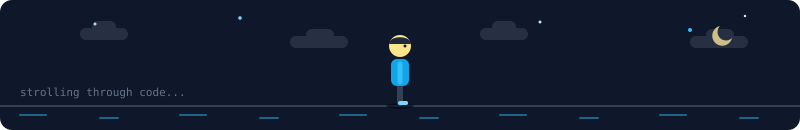

<div align="center">
  
</div>

<p align="center">
  <a href="https://www.cakwei.dev" target="_blank">
    
  </a>
  <a href="https://www.linkedin.com/in/charlee-tan-1833902b6/" target="_blank">
    
  </a>
  <a href="https://www.cakwei.dev/resume" target="_blank">
    
  </a>
  <a href="https://www.credly.com/users/charlee-tan" target="_blank">
    
  </a>
  <a href="mailto:charlee@cakwei.dev">
    
  </a>
  
</p>

---

### 🧑‍💻 About Me

```yaml
name: "Charlee Tan"
location: "APU, Malaysia"
currently_learning: "Tauri"
portfolio: "https://www.cakwei.dev"
contact: "charlee@cakwei.dev"
fun_fact: "I am way too chill on the outside ⚡"
```

---

### 🛠️ Languages & Tools

<p align="center">
  <a href="https://skillicons.dev">
    
  </a>
</p>

---

### 📊 GitHub Stats

<p align="center">
  
  
</p>

---

### 🐍 Contribution Snake

<p align="center">
  <picture>
    <source media="(prefers-color-scheme: dark)" srcset="https://raw.githubusercontent.com/cakwei/cakwei/output/github-contribution-grid-snake-dark.svg" />
    <source media="(prefers-color-scheme: light)" srcset="https://raw.githubusercontent.com/cakwei/cakwei/output/github-contribution-grid-snake.svg" />
    
  </picture>
</p>

---

<p align="center">
  
</p>

<div align="center">
  
</div>
